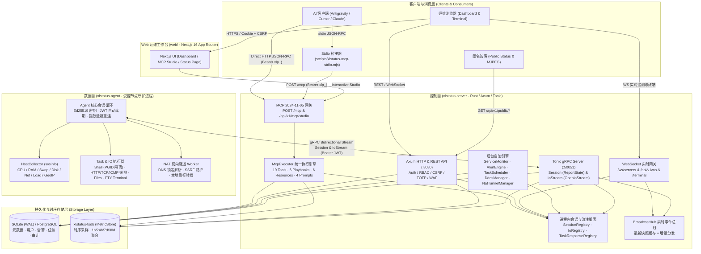
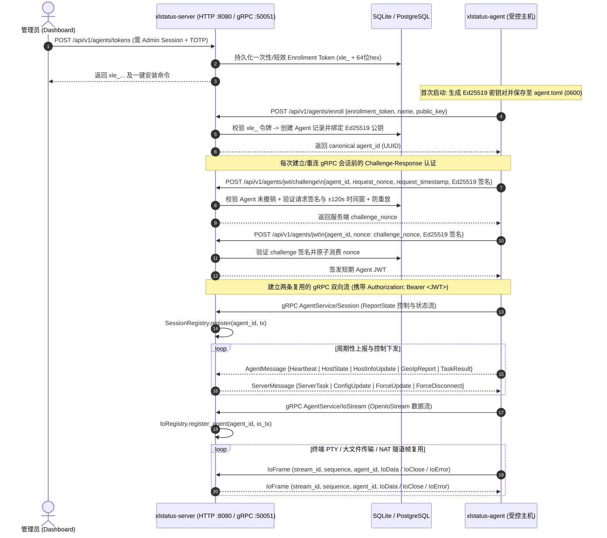
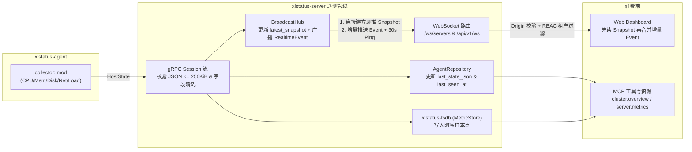
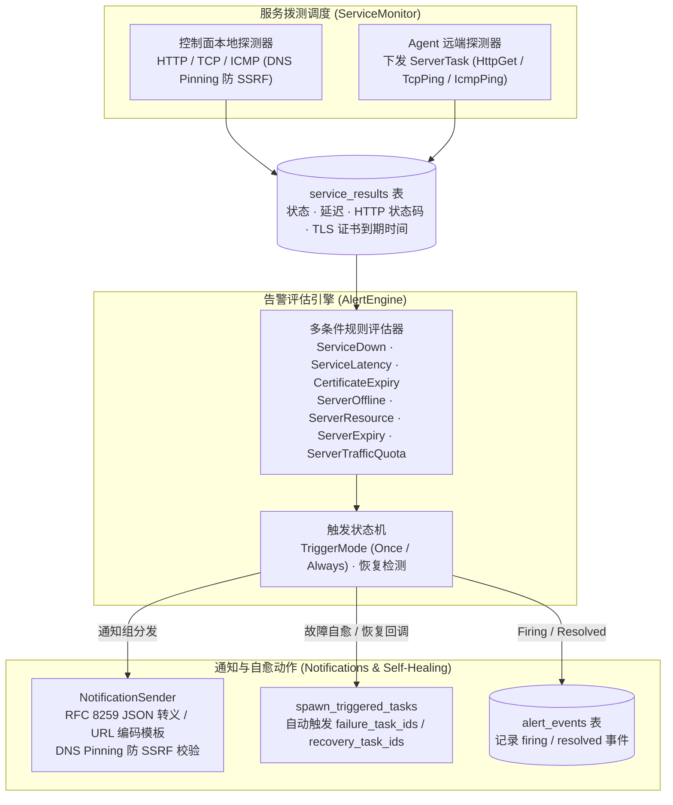
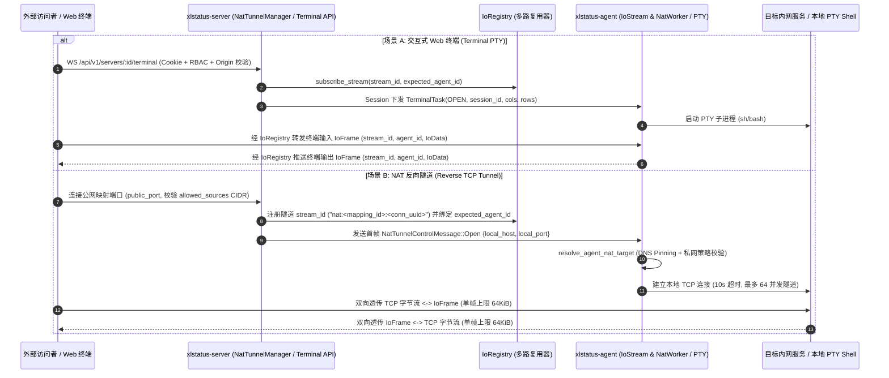
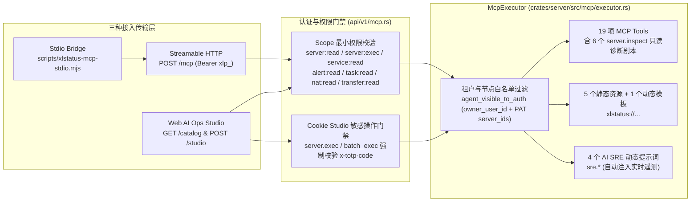

# 系统技术架构参考 (Technical Architecture Reference)

本文档提供 **XLStatus** 当前生产发布形态的完整技术架构说明，涵盖控制面（Control Plane）、数据面（Data Plane）、Web 运维工作台（Web Workbench）与 AI-Native MCP 引擎的拓扑关系、核心组件职责、五大关键业务数据流及安全信任边界。

---

## 1. 总体系统拓扑 (Control Plane, Data Plane, Web Workbench & AI MCP Topology)

XLStatus 采用**集中式控制面 + 反向长连接 Agent 数据面 + 原生 AI MCP 接口层**的三层解耦架构。被监控主机无需开放任何入站公网端口（除可选的 NAT 映射目标服务外），所有状态上报、远程命令、终端 PTY、文件传输、服务拨测与 NAT 反向隧道均复用 Agent 主动向 Server 发起的 gRPC 双向流。

---

## 2. 核心组件拆解 (Component Breakdown)

| 组件 / Crate | 路径 | 核心职责与架构定位 |
|---|---|---|
| **`xlstatus-server`** | `crates/server` | **控制面核心二进制**。基于 Axum 提供 REST API、WebSocket 实时流、公开状态页（含 MJPEG 流）与 MCP `2024-11-05` 端点；基于 Tonic 提供 Agent gRPC 服务；内置 SQLite/PostgreSQL 自动迁移、WAF 封禁、RBAC/PAT 鉴权、TOTP 二次验证，以及服务拨测、告警引擎、定时任务、DDNS、NAT 隧道等后台自治循环。 |
| **`xlstatus-agent`** | `crates/agent` | **数据面节点守护进程**。负责使用 Enrollment Token (`xle_`) 完成首次注册并生成本地 `0600` 权限的 Ed25519 密钥对；通过 Challenge-Response 换取短期 JWT 建立 gRPC `Session` 与 `IoStream` 双向流；周期性采集主机硬件与实时指标，并按需执行远程 Shell（独立进程组隔离）、服务探测、文件读写、PTY 终端会话与 NAT 端口转发。 |
| **`xlstatus-tsdb`** | `crates/tsdb` | **时序指标存储引擎 (`MetricStore`)**。为高频上报的 `HostState` 指标提供统一的写入与多时间窗口查询门面（`15m` / `1h` / `6h` / `24h` / `7d` / `30d`），支持统计聚合（`min` / `max` / `avg` / `latest`）与降采样输出。 |
| **`xlstatus-shared`** | `crates/shared` | **跨端领域模型与安全契约库**。定义强类型 ID（`AgentId`、`UserId`）、RBAC 角色与 Scope 常量（`authz.rs`）、任务选择器（`ServerSelector`）、终端协议帧、DDNS 模型以及 NAT 控制帧（`NatTunnelControlMessage`）。 |
| **`xlstatus-proto-gen`** | `crates/proto-gen` | **Protobuf 与 gRPC 编译层**。通过 `tonic-build` 编译 `proto/xlstatus/v1/{agent,common,nat}.proto`，向 `server` 与 `agent` 导出强类型的 Rust 消息结构与 `AgentService` 服务端/客户端桩代码。 |
| **`web`** | `web/` | **Next.js 16 现代化运维工作台**。采用 App Router、React 19 与 Tailwind CSS v4 构建，提供实时监控大盘、世界节点地图、在线 Web 终端、文件传输器、服务 SLA 大盘、告警与通知编排、NAT/DDNS 配置、MCP AI Ops Studio 以及匿名公开状态页。 |

---

## 3. 五大核心业务数据流 (Key Data Flows)

### 3.1 Agent 注册认证与 gRPC 双向流生命周期
**(Agent Enrollment & gRPC Bidirectional Stream: `ReportState` / `Session` & `OpenIoStream` / `IoStream`)**

Agent 接入采用**一次性注册令牌 + Ed25519 非对称密钥 Challenge-Response + 短期 JWT** 的零明文口令传输机制，确保即使 Enrollment Token 过期，已注册节点仍可通过私钥安全续期连接，且管理员撤销后立即阻断。

### 3.2 实时遥测采集与分发流水线 (Real-time Telemetry Pipeline)

Agent 采集的主机指标在到达控制面后，同时写入关系库最新状态快照、时序数据库 `xlstatus-tsdb` 与内存级 `BroadcastHub`，从而实现 Web 大盘“首屏零闪烁秒开 + 增量毫秒级推送”。

- **双 WebSocket 端点**：
  - `/ws/servers`（`crates/server/src/realtime/ws.rs`）：连接建立后立即下发当前用户可见节点的 `{"type":"snapshot","events":[...]}`，随后实时转发 `{"type":"event","event":{...}}` 与 30 秒一次的 `{"type":"ping"}`，并动态校验节点可见性与撤销状态。
  - `/api/v1/ws`（`crates/server/src/api/v1/ws.rs`）：支持客户端按需发送 `{"type":"subscribe","channels":["servers","alerts"]}` 订阅多频道实时事件。

### 3.3 服务拨测与告警自愈流水线 (Service Monitoring & Alert Engine Pipeline)

XLStatus 支持**控制面本地探测 (`local`)** 与 **分布式 Agent 节点探测 (`agent`)** 两种拨测模式，并将拨测结果与主机遥测统一汇入告警评估引擎，触发安全转义的 Webhook 通知与自动化自愈任务。

- **RFC 8259 安全模板渲染**：`NotificationSender` 在渲染自定义 JSON Webhook 模板（如 `{{title}}`、`{{message}}`、`{{severity}}`）时，严格按 RFC 8259 对双引号、反斜杠与控制字符进行转义；对 `application/x-www-form-urlencoded` 模板进行百分号编码，杜绝告警载荷注入破坏 JSON 结构。
- **出站 SSRF 防护**：无论是本地 HTTP 拨测还是 Webhook 通知发送，均通过 `crates/server/src/security.rs` 执行 DNS 解析结果校验与 IP 绑定（DNS Pinning），默认拦截指向回环、链路本地、云元数据（`169.254.169.254`）与未授权私网地址的请求。

### 3.4 交互式终端与 NAT 反向隧道多路复用 (`IoRegistry` Multiplexing)

终端会话与 NAT 内网穿透共享 `AgentService/IoStream` 通道，由控制面的 `IoRegistry` 按 `stream_id` 进行多路复用，并强制执行每个流的 `agent_id` 归属权校验。

- **单流归属隔离 (`expected_agent_id`)**：`IoRegistry` 在注册任意终端或 NAT `stream_id` 时都会记录目标 `agent_id`。当 Agent 上报 `IoFrame` 时，若帧来源的认证 `agent_id` 与该 `stream_id` 绑定的 `expected_agent_id` 不一致，控制面直接丢弃并拒绝跨节点串流劫持。
- **Agent 端 DNS 锁定拨号**：Agent 在处理 `NatTunnelControlMessage::Open` 时，使用 `resolve_agent_nat_target` 完成主机名解析与目标地址策略校验，防止恶意映射通过 DNS 重绑定攻击 Agent 所在宿主机。

### 3.5 AI-Native MCP 统一执行引擎 (`McpExecutor`)

XLStatus 将 AI 运维能力深度内建于控制面核心，`McpExecutor` 统一编排 **Tools（工具）**、**Resources（`xlstatus://` 资源）** 与 **Prompts（SRE 提示词模板）**，并与 Web/REST 共享同一套 RBAC 与 PAT 节点隔离模型。

---

## 4. 安全与信任边界汇总 (Security & Trust Boundaries)

1. **浏览器与 Web 控制台边界**：
   - 登录态采用 HttpOnly Session Cookie，所有状态变更请求（`POST` / `PUT` / `PATCH` / `DELETE`）强制校验 `x-csrf-token` 头部。
   - CORS 严禁配置 `*`，WebSocket 升级请求强制验证 `Origin` 是否在 `server.cors_allowed_origins` 白名单内。
   - 当管理员启用 TOTP 后，签发 Enrollment Token、撤销 Agent、绑定/解绑 OAuth 以及在 Web MCP Studio 中调用 `server.exec` / `server.batch_exec` 均强制要求提供有效的 `x-totp-code`。
2. **Agent 与控制面边界**：
   - Agent 配置文件（包含 Ed25519 私钥）权限强制锁定为 `0600`。
   - Agent gRPC 端口在 Docker Compose 与 `systemd` 安装脚本中默认绑定 `127.0.0.1:50051`，防止未加密 gRPC 意外暴露公网。
   - 远端 Shell 执行在 Unix 上为每个任务创建独立进程组（PGID），任务超时、取消或流断开时由 `Drop` 守卫向整个进程组发送终止信号，防止后台子进程残留。
3. **PAT 与 AI MCP 边界**：
   - PAT 令牌（`xlp_...`）仅存储 SHA-256 哈希，支持细粒度 Scope 与 `server_ids` 节点白名单。
   - 为防范提示词注入（Prompt Injection）导致远端文件被篡改，MCP 层彻底移除了文件写入、删除与上传 URL 生成工具（`fs.write`、`fs.delete`、`fs.upload_url`），仅开放只读文件系统能力（`fs.list`、`fs.read`、`fs.download_url`）。
4. **协议级输入与内存保护边界**：
   - HTTP 原始路径上限 `4096` 字节，Query String 上限 `16KiB`；MCP JSON-RPC 请求体上限 `1MiB`，单次批处理最多 `16` 项；Stdio 桥接器单行上限 `1MiB` 并自动脱敏 `xlp_` / `xle_` 令牌。

---

## 5. 发布与部署拓扑 (Release & Deployment Topologies)

### 5.1 Docker Compose 拓扑
仓库提供三套开箱即用的 Compose 编排文件：
- `docker-compose.yml`：标准 SQLite（挂载 `./data`）+ Server + Web 生产编排。
- `docker-compose.pg.yml`：PostgreSQL + Server + Web 生产高可用编排。
- `docker-compose.simple.yml`：快速本地验证编排。

> [!IMPORTANT]
> 远端部署修改 `XLSTATUS_PUBLIC_API_URL` 或 `XLSTATUS_CORS_ALLOWED_ORIGINS` 后，必须重新执行 `docker compose build web` 以更新前端 bundle 中的 API 地址。

### 5.2 systemd 原生守护进程拓扑
- `deploy/install.sh`：自动检测 Linux 架构（`x86_64` / `arm64` / `i386`），安装 `xlstatus-server` 与 `/etc/systemd/system/xlstatus-server.service`。
- `deploy/install-agent.sh`：支持从 GitHub Release（默认 fallback `v0.3`）下载对应架构二进制，完成节点 enrollment 并注册 `xlstatus-agent.service`。

### 5.3 GitHub Release 多平台构建矩阵
推送 `v*` 标签后，`.github/workflows/` 自动交叉编译并发布 10 种平台架构的 `server` 与 `agent` 二进制资产：
- **Linux**：`x86_64`、`arm64`、`i386`
- **Windows**：`x86_64.exe`、`arm64.exe`、`i386.exe`
- **macOS (Darwin)**：`x86_64`、`arm64`
- **FreeBSD**：`x86_64`、`i386`
- **安装器脚本**：`install-server.sh`、`install-agent.sh`
