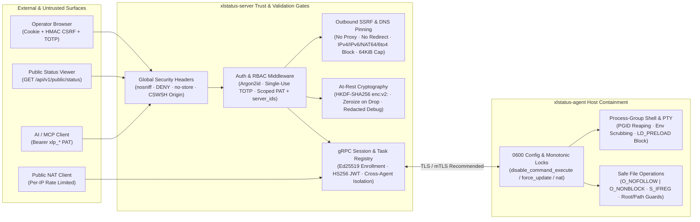

# XLStatus Security Architecture, Threat Model & Hardening Reference

XLStatus is a high-privilege infrastructure monitoring and cluster operations platform capable of remote command execution, interactive PTY terminals, remote filesystem access, NAT reverse port forwarding, OTA binary updates, database backup/restore, and AI Agent (`MCP 2024-11-05`) automation.

Because compromise of any single boundary could impact managed fleet nodes, XLStatus enforces a **Defense-in-Depth Security Architecture** backed by **three comprehensive rounds of security auditing, exploit mitigation, and automated regression testing** (835+ Rust workspace tests and 14 frontend security unit tests).

---

## Security Architecture Overview

---

## 1. Authentication, Session & Access Control (RBAC / PAT / TOTP / CSRF)

### 1.1 Password Hashing & Anti-Enumeration Timing Protection
- **Argon2id Password Hashing**: User passwords are hashed with Argon2id (`m=19456, t=2, p=1`). Password inputs are strictly validated to reject empty strings, embedded `NUL` bytes, and inputs exceeding `1024` bytes (`crates/server/src/db/repository/user.rs`) to prevent CPU exhaustion DoS via multi-megabyte password payloads.
- **Constant-Time Login Enumeration Mitigation**: When a login attempt targets a non-existent username, `verify_dummy_login_password` (`crates/server/src/api/v1/auth.rs`) computes an Argon2id verification against a pre-generated dummy hash with identical parameters, eliminating username existence timing side-channels.

### 1.2 Single-Use TOTP 2FA, Brute-Force Lockout & Step-Up Elevation
- **Single-Time-Step Atomic Consumption**: TOTP codes (`crates/server/src/auth/totp.rs`, `crates/server/src/api/v1/auth.rs`) are compared using constant-time byte comparison (`constant_time_6_digit_eq`) and recorded per user and time-step (`totp_step_used:<step>`). A 6-digit code cannot be replayed within its 30-second validity window.
- **Per-User Brute-Force Lockout**: Exceeding 5 failed TOTP verifications within 15 minutes locks out TOTP validation for that user, preventing attackers with a stolen session cookie from brute-forcing `x-totp-code`.
- **Mandatory Step-Up Verification (`x-totp-code`)**: High-risk operations—including remote shell task creation, force agent updates, SQLite database restore, and Cookie-authenticated MCP Studio command execution (`server.exec` / `server.batch_exec`)—require an active, unconsumed `x-totp-code` header whenever the administrator has 2FA enabled.

### 1.3 Session Bounds, Instant Credential Revocation & HMAC-SHA256 CSRF
- **Per-User Active Session Cap**: `MAX_ACTIVE_SESSIONS_PER_USER = 32` (`crates/server/src/auth/session.rs`) automatically prunes expired sessions and evicts the oldest sessions (FIFO) upon login, preventing session table exhaustion.
- **Immediate Revocation on Role Demotion or Deletion**: Demoting a user's role or deleting an account invokes `revoke_user_credentials` (`crates/server/src/api/v1/auth.rs`), atomically purging all active browser sessions and Personal Access Tokens (PATs) for that user.
- **Standard HMAC-SHA256 CSRF**: Browser cookie mutations require a CSRF token derived via standard `Hmac<Sha256>` (`derive_csrf_token` in `crates/server/src/auth/mod.rs`) and verified in constant time.

### 1.4 Fine-Grained Personal Access Tokens (`xlp_`) & Tenant Isolation
- **Privilege Escalation Prevention**: Non-admin users are barred from minting PATs containing administrative or destructive scopes (`inventory:delete`, `ddns:write`, `ddns:delete`). Passing an empty `server_ids: []` array is rejected (`400 Bad Request`) so callers cannot accidentally bypass node allowlists.
- **No Silent Cookie Fallback**: Requests presenting an invalid or expired `Authorization: Bearer` header fail immediately with `401 Unauthorized` (`crates/server/src/auth/middleware.rs`) rather than falling back to ambient browser cookies.
- **Live Ownership & `CoverMode` Re-Verification**: Every authenticated request re-verifies that the PAT is unrevoked and that all referenced `server_ids` and `group_ids` (`ensure_selector_groups_owned`) belong to the token owner. Scoped PATs with a `server_ids` allowlist are restricted to `CoverMode::Specific` tasks and services with empty `exclude_server_ids`.

---

## 2. Cryptography & At-Rest Secret Protection

### 2.1 `HKDF-SHA256` Domain-Separated At-Rest Encryption (`enc:v2:`)
- **Key Derivation & AEAD**: Sensitive database columns (TOTP secrets, OIDC client secrets, notification webhook URLs/headers, DDNS provider credentials, Cloudflared tokens) are encrypted at rest (`crates/server/src/secrets.rs`). Master keys are derived via **`HKDF-SHA256`** with explicit domain separation (`enc:v2:`), while retaining transparent backward-compatible decryption for legacy `enc:v1:` ciphertexts.
- **Pre-Decode Size Gate & Zeroization on Drop**: Ciphertext payloads are length-checked before hex decoding to prevent memory allocation amplification, and derived key material in `SecretCrypto` is explicitly zeroed in memory upon `Drop`.

### 2.2 Strict JWT Pinning (`HS256`) & Entropy Checks
- **Algorithm & Claim Enforcement**: `crates/server/src/auth/jwt.rs` caps token size at `MAX_JWT_BYTES = 4096`, pins `Algorithm::HS256` both before and during decoding, requires non-empty `jti`, and rejects tokens with future `iat` clock skew exceeding `60` seconds. Signing secrets are validated for minimum length and character entropy.

### 2.3 Comprehensive Log & `fmt::Debug` Redaction
- **Struct-Level `Debug` Redaction**: Custom `fmt::Debug` implementations on `SecretCrypto`, `ServerConfig`, `DatabaseConfig`, `SecurityConfig`, `OidcProviderConfig`, `User`, `Session`, `PersonalAccessToken`, `EnrollmentToken`, `TemporaryTransferToken`, and `DdnsConfigRow` mask all secret fields as `<redacted>`.
- **Outbound Error & Realtime Broadcast Scrubbing**:
  - `sanitize_notification_error` (`crates/server/src/api/v1/notifications.rs`) and `sanitize_service_result_error` (`crates/server/src/api/v1/service_history.rs`) strip embedded BasicAuth credentials, Webhook path tokens, private IP literals, and sensitive query parameters from `reqwest::Error` strings before logging or storing probe history.
  - `redact_token_with_secret` (`crates/server/src/api/v1/cloudflared.rs`) scrubs full Cloudflared tunnel tokens from process output.
  - `BroadcastHub::publish` (`crates/server/src/realtime/mod.rs`) recursively strips keys matching `token`, `secret`, `password`, `private_key`, or `authorization` and filters control characters before pushing events over WebSockets.

---

## 3. Agent Control Plane, gRPC Session Security & Host Isolation

### 3.1 Ed25519 Enrollment (`xle_`) & Bounded Challenge Registry
- **Cryptographic Enrollment**: Agents enroll using single-use `xle_` tokens and an Ed25519 public key, followed by challenge-response signature verification (`crates/server/src/api/v1/agent_jwt.rs`).
- **Challenge DoS Protection**: Unconsumed challenges and replay records are bounded per agent (`MAX_CHALLENGE_RECORDS_PER_AGENT`). Revoking or deleting an agent immediately purges its challenge state, active gRPC session, and server group bindings.
- **Telemetry Sanitization & Frame Ownership**: Incoming gRPC `HostState` and `HostInfo` payloads are scrubbed of `NaN`/`Infinity` floats and control characters (`crates/server/src/grpc/server.rs`). Untrusted agent telemetry cannot overwrite server-managed `public_note` fields. Both `TaskResponseRegistry` and `IoRegistry` (`crates/server/src/grpc/session.rs`) verify `agent_id` ownership to prevent cross-agent task result spoofing and enforce global capacity caps (`4096` pending tasks, `1024` IO waiters) with cancellation-safe `Drop` cleanup.

### 3.2 `0600` Key Persistence & Monotonic Local Security Locks
- **Atomic `0600` Config Writes**: `write_secure_config` (`crates/agent/src/main.rs`) writes `agent.yaml` (containing the Ed25519 private key and JWT) via a same-directory temporary file opened with `O_NOFOLLOW` and `0600` permissions before atomic `rename`.
- **One-Way Monotonic Security Flags**: Local host security flags (`disable_command_execute`, `disable_force_update`, `disable_auto_update`, `disable_nat`, `disable_send_query`) act as **monotonic locks**. Once enabled on the host, a remote `ConfigUpdate` pushed by the control plane cannot re-enable them or widen `file_allowed_roots`.

### 3.3 Safe Remote Filesystem Operations (`O_NOFOLLOW | O_NONBLOCK`)
- **FIFO / Device Node Hang Prevention**: `crates/agent/src/executor/files.rs` opens target files on Unix with `O_NONBLOCK | O_NOFOLLOW` and inspects `fstat` metadata (`S_IFREG`) **before** reading, writing, or truncating—rejecting named pipes (FIFOs), sockets, symlinks, and block/character devices that could otherwise hang worker threads indefinitely.
- **Size Caps, Mode Masking & Root Path Guards**: Single file reads are capped (`100 MiB` hard ceiling, `2 MiB` default when `length=0`). File writes reject `setuid`, `setgid`, and `sticky` bits (`mode & !0o777 == 0`). `is_filesystem_root_path` (`crates/server/src/api/v1/server_ops.rs`) blocks deletion of `/`, `//`, `/.`, and traversal aliases, while `force_update` validates release version strings against path traversal (`..`).

### 3.4 Process-Group Shell Execution, Environment Scrubbing & PTY Containment
- **Process-Group (`PGID`) Reaping & Pipe Drain**: Unix shell tasks (`crates/agent/src/executor/shell.rs`) spawn in a dedicated process group. On timeout, cancellation, or future abort, the `Drop` guard signals the entire process group and reaps the child. Output readers continue draining pipes after hitting the memory truncation cap so commands do not fail spuriously with `SIGPIPE`.
- **Environment Variable Scrubbing & Linker Hijack Prevention**: Child processes strip inherited agent secrets (`XLSTATUS_ENROLL_TOKEN`, `XLSTATUS_AGENT_JWT`, `XLSTATUS_PRIVATE_KEY`) and reject task environment variables containing `LD_PRELOAD`, `DYLD_INSERT_LIBRARIES`, `BASH_ENV`, `ENV`, `PROMPT_COMMAND`, or control characters.
- **Bounded PTY Sessions**: Concurrent WebSocket PTY sessions per agent are capped at `MAX_TERMINAL_SESSIONS = 16` (`crates/agent/src/executor/terminal.rs`), blocking `child.wait()` calls run inside `spawn_blocking`, and session teardown sends `SIGHUP`/`SIGKILL` to `-pid`.

---

## 4. Network Data Plane, Outbound SSRF & NAT Tunnel Hardening

### 4.1 DNS-Pinned Outbound SSRF Protection & IPv6 Transition Blocking
- **Comprehensive IP Blocklist (`crates/server/src/security.rs`)**: Outbound connections (Webhooks, GeoIP, DDNS, Server HTTP/TCP/ICMP probes, Agent HTTP probes, and `HttpGet`/`IcmpPing`/`TcpPing` tasks) block:
  - IPv4 loopback (`127.0.0.0/8`), RFC 1918 private ranges, link-local / cloud metadata (`169.254.0.0/16`, `100.100.100.200`), CGNAT (`100.64.0.0/10`), multicast, and broadcast.
  - IPv6 loopback (`::1`), unspecified (`::`), Unique Local (`fc00::/7`), link-local (`fe80::/10`), multicast (`ff00::/8`), **IPv4-mapped (`::ffff:0:0/96`)**, **IPv4-compatible (`::/96`)**, **SIIT IPv4-translated (`::ffff:0:0:0/96`)**, **NAT64 (`64:ff9b::/96`, `64:ff9b:1::/48`)**, and **6to4 (`2002::/16`)** embedding any non-global IPv4 address.
  - Bracketed IPv6 literals (`[::1]`) are parsed directly without falling back to DNS, and ICMP/TCP ping targets starting with `-` are rejected to prevent flag injection.
- **DNS Pinning (`resolve_to_addrs`), Proxy Disablement & `64 KiB` Streaming Caps**: Both Server (`crates/server/src/notifications/sender.rs`, `crates/server/src/services/probe.rs`, `crates/server/src/ddns/provider.rs`) and Agent (`crates/agent/src/executor/http.rs`) outbound HTTP clients explicitly disable system proxies (`.no_proxy()`), disable automatic redirects (`redirect::Policy::none()`), pin validated `SocketAddr` results via `.resolve_to_addrs(host, &resolved_addrs)` to defeat DNS rebinding, and read response bodies via a **`64 KiB` streaming chunk cap**.

### 4.2 NAT Reverse Tunnel Data-Plane Isolation
- **Cross-Agent `tunnel_id` Hijack Prevention**: `deliver_agent_frame` and `bridge_over_iostream` (`crates/server/src/nat/manager.rs`, `crates/server/src/nat/tunnel.rs`) verify that `frame.agent_id` matches the owner of `tunnel_id` in `active_tunnels`, preventing a compromised Agent A from injecting frames into or closing Agent B's tunnels.
- **Port Guards, Frame Caps & Bounded Rate-Limit Tables**: NAT mappings block privileged ports (`< 1024`) and control-plane ports (`3000`, `8080`, `50051`), cap individual data frames at `64 KiB` with slow-client write timeouts, and bound per-mapping source IP rate-limit tables to `4096` entries.
- **Agent-Side Local Dial Pinning**: `crates/agent/src/nat/mod.rs` resolves and validates all target `SocketAddr` entries (blocking cloud metadata `169.254.169.254`, multicast, and public IPs unless explicitly permitted) before dialing the pinned socket address directly.

---

## 5. Database Layer, TSDB & Concurrency Safety

- **SQLite `LIMIT -1` Full-Scan Prevention**: All paginated queries across all 8 repository modules (`agent.rs`, `alerts.rs`, `ddns.rs`, `nat.rs`, `pat.rs`, `tasks.rs`, `temporary_transfer.rs`, `user.rs`) clamp `limit.clamp(1, 500)` and `offset.max(0)`, preventing negative `LIMIT` values from triggering unbounded full-table scans in SQLite.
- **Atomic Single-Use Token Consumption via `julianday()`**: Enrollment tokens (`xle_`) and temporary file transfer tokens (`xlt_`) evaluate expiration in SQLite using `julianday(expires_at) > julianday(?)` within an atomic `UPDATE ... WHERE used_count < max_uses` statement, eliminating ISO-8601 string format ordering discrepancies.
- **Pre-DB Rate Limiting on Temporary Transfers**: `/api/v1/transfers/*` enforces bounded (`4096`-slot) per-IP rate limiting **before** querying the database, sanitizes `Content-Disposition` filenames, and sets `X-Content-Type-Options: nosniff`.
- **SQLite Restore Verification (`validate_sqlite_backup_bytes`)**: Uploaded SQLite backups (`crates/server/src/api/v1/maintenance.rs`) are verified for the 16-byte `SQLite format 3\0` header, opened with `PRAGMA trusted_schema = OFF`, checked with `PRAGMA quick_check(1)`, and scanned against `sqlite_master` to reject images containing malicious `TRIGGER`, `VIEW`, or `VIRTUAL TABLE` objects.
- **PostgreSQL Migration Allowlist**: `scripts/import_sqlite_to_postgres.py` enforces a strict table/column identifier allowlist, validates source SQLite integrity, runs inside a single transaction without `TRUNCATE ... CASCADE`, and redacts database DSNs in logs.
- **TSDB Input Bounds**: `crates/tsdb/src/lib.rs` caps individual metric samples at `64 KiB`, limits JSON nesting depth (`<= 16`), and rejects timestamps more than `24h` in the future.

---

## 6. AI / MCP (`2024-11-05`) Security Boundaries

- **Unified Tenant & Node Allowlist Enforcement**: All 19 MCP tools and 6 `xlstatus://` resources (`crates/server/src/mcp/executor.rs`) enforce both user ownership (`owner_user_id`) and the PAT's `server_ids` allowlist—including aggregate tools like `cluster.overview`, `cluster.diagnose`, `service.list`, `service.history`, `alert.events`, `alert.rules`, `task.list`, and `network.topology`.
- **Least-Privilege Scope Mapping**: Every MCP tool and resource requires explicit scopes (`inventory:read`, `service:read`, `alert:read`, `task:read`, `task:write`, `files:read`, `nat:read`, `ddns:read`). Remote file writes (`fs.write`) are disabled for PATs to prevent unattended file tampering.
- **Web Studio Step-Up TOTP Enforcement**: Executing `server.exec` or `server.batch_exec` via `/api/v1/mcp/studio` under a browser Cookie session enforces `check_mcp_studio_sensitive_totp` (`crates/server/src/api/v1/mcp.rs`).
- **Stdio Bridge Memory & Token Protection**: `scripts/xlstatus-mcp-stdio.mjs` enforces a `1 MiB` per-line stdin buffer ceiling and automatically redacts `xlp_*` and `Bearer` tokens from any error diagnostics written to `stderr`.

---

## 7. Frontend & HTTP Defense-in-Depth

- **Global Security Response Headers**: Both the Rust API server (`crates/server/src/main.rs`) and Next.js (`web/next.config.ts`) emit `X-Content-Type-Options: nosniff`, `X-Frame-Options: DENY`, `Referrer-Policy: strict-origin-when-cross-origin`, and restrictive `Permissions-Policy`. All `/api/*` and `/mcp/*` responses enforce `Cache-Control: no-store`.
- **WebSocket CSWSH & Live Revocation Checks**: Terminal WebSocket upgrades (`/api/v1/terminal/sessions/:id/ws`) validate the browser `Origin` header, reject PAT authentication, atomically consume the `session_id` once, and validate `u16` terminal dimensions without integer truncation. Realtime telemetry streams (`/ws/servers`) cap incoming frames at `4096` bytes and re-verify node ownership and revocation status before delivering every event.
- **Public Status DTO Stripping & Output Sanitization**: `GET /api/v1/public/status` (`crates/server/src/api/v1/public.rs`) projects nodes through `PublicAgentSummary` (stripping private `remark`, `expires_at`, `renewal_price`, `public_key`, and raw `last_info_json`) and re-sanitizes brand URLs and theme CSS variables on output.
- **Client-Side Path Segment & URL Sanitizers (`web/app/lib/security.ts`)**:
  - `encodePathSegment` blocks `.` and `..` (including `%2e` / `%2e%2e`) across all dynamic route parameters in `web/lib/api.ts` to prevent WHATWG URL dot-segment path normalization traversal.
  - `sanitizeExternalUrl`, `sanitizeImageSrcUrl`, `sanitizeCssColorValue`, `resolveSafeApiUrl`, and `escapeShellDoubleQuoted` protect against `javascript:`/`data:text/html` XSS, CSS `url(...)` injection, cross-origin file transfer redirects, and shell snippet escaping bugs.
  - Ephemeral enrollment token caches in `/tokens` are stored in `sessionStorage` rather than `localStorage` and explicitly cleared on `apiClient.logout()`.

---

## 8. Production Deployment & Residual Risk Guidelines

| Area | Residual Boundary & Operational Requirement |
| :--- | :--- |
| **Remote Agent gRPC (`:50051`)** | Docker Compose and systemd installers bind gRPC to `127.0.0.1:50051` by default. When exposing gRPC across untrusted networks (`XLSTATUS_GRPC_PUBLISH_ADDRESS=0.0.0.0`), operators **must** configure gRPC TLS/mTLS or run over an encrypted mesh VPN (WireGuard/Tailscale). |
| **Daemonized Child Processes (`setsid`)** | On Unix, shell task timeouts terminate the initial process group (`-pgid`). A privileged command that intentionally calls `setsid()` / double-forks can escape PGID signaling; run `xlstatus-agent` inside a systemd unit (`KillMode=control-group`) or container cgroup for full OS-level containment. On Windows, job-object containment is recommended for deep process trees. |
| **Outbound Proxy Environments** | Because XLStatus disables ambient `HTTP_PROXY`/`HTTPS_PROXY` environment variables to guarantee DNS-pinned SSRF validation, deployments that require outbound egress proxies should enforce private-range blocking at an explicit egress gateway. |
| **Bootstrap & Enrollment Links** | Parameterized Agent install commands contain short-lived `xle_` enrollment tokens. Distribute them only over encrypted channels and keep token TTLs short. |
